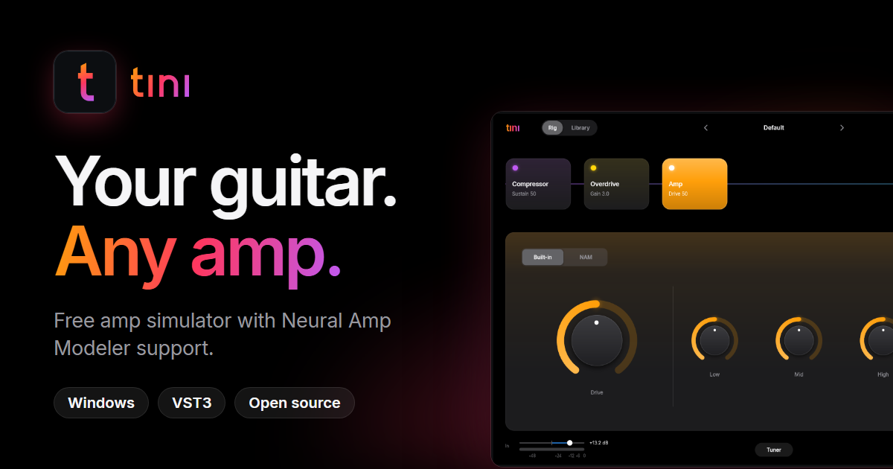
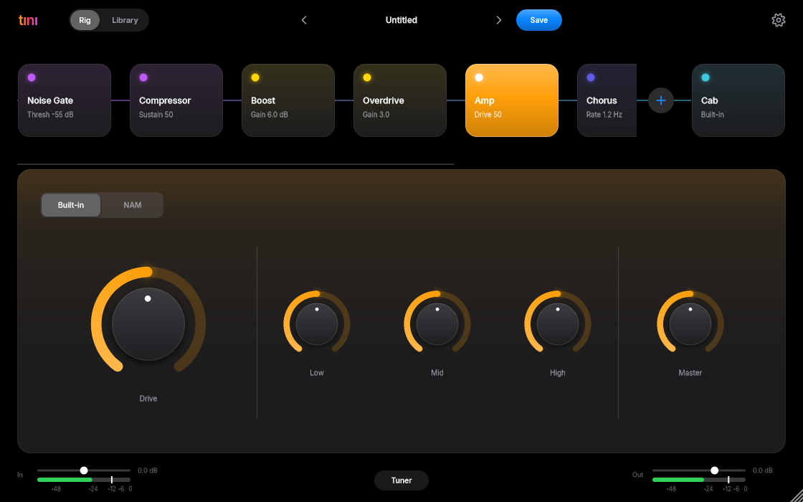
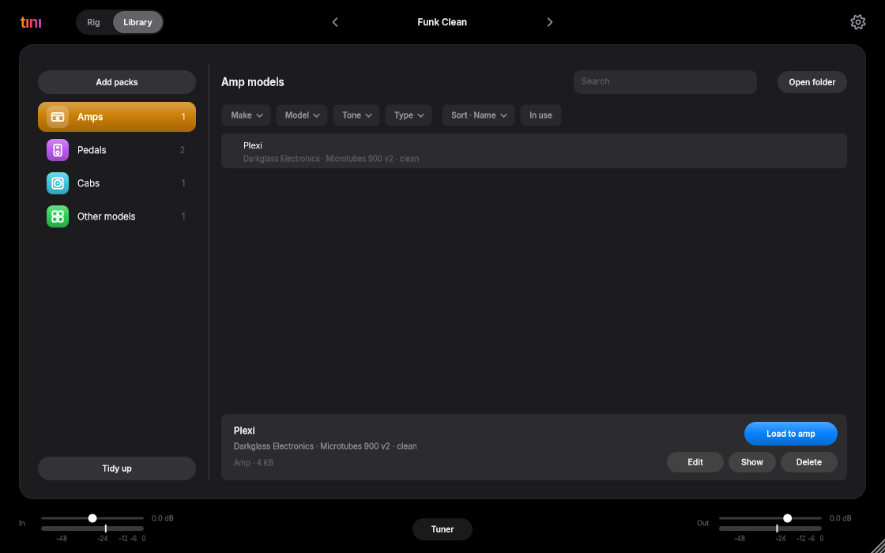
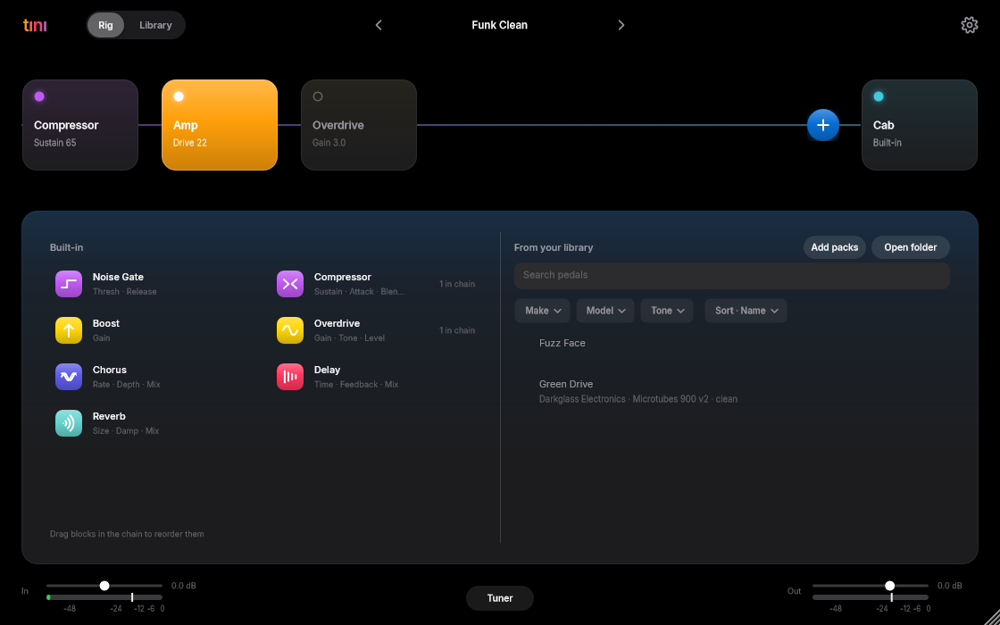
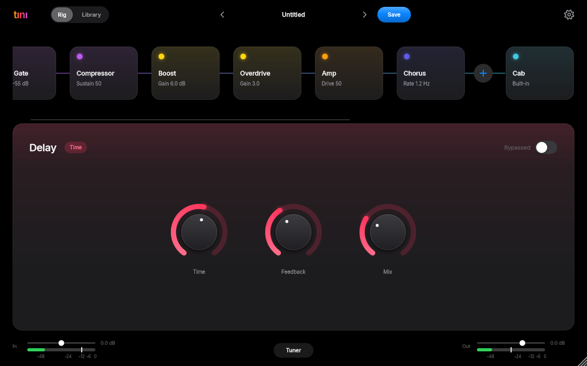
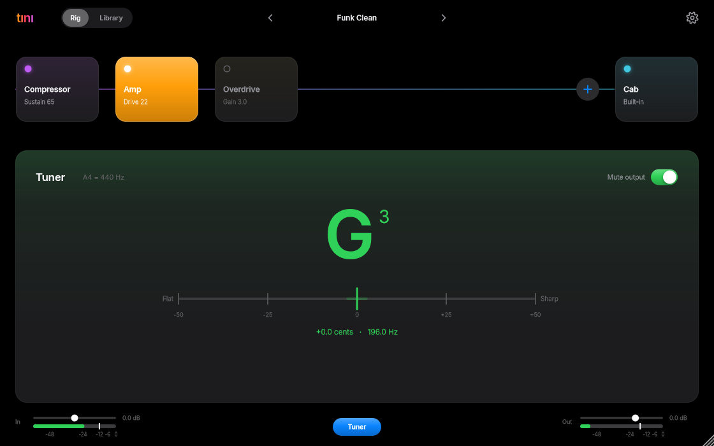
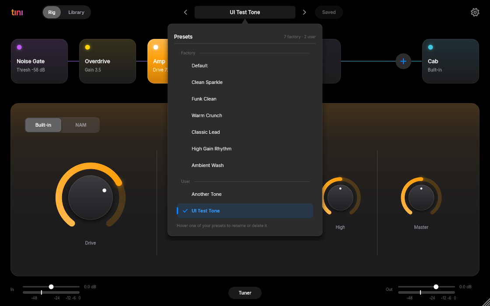

<div align="center">



<br />

**A free guitar amp for your PC, with real [Neural Amp Modeler](https://www.neuralampmodeler.com) support.**<br />
Load captures of real amps, add a pedal board you can rearrange, run it standalone or as a VST3 in your DAW.

[](https://github.com/Sezergumus/tini/releases/latest)
[](https://sezergumus.github.io/tini/)


<br />



</div>

---

## Why tını?

Most amp sims are either locked to their own models or hide the good stuff behind a paywall.
tını is the opposite: **bring any `.nam` capture** (there are thousands of free ones on
[TONE3000](https://www.tone3000.com)), drop it on the window, and play. No account, no subscription, no installer.

- **Plays like a rig, not a settings panel.** Your signal chain is a row of blocks. Drag the amp or any pedal to a new place and the sound follows.
- **Your gear in one library.** Amp captures, pedal captures, cabinet IRs, sorted by what the files say about themselves. Drop files or zips on the window and they are filed for you.
- **Honest numbers.** The standalone shows the real round-trip latency of your audio device, not the buffer size.
- **Small and free.** One 7 MB app, AGPL-3.0 licensed, built on [JUCE](https://juce.com) and [NeuralAmpModelerCore](https://github.com/sdatkinson/NeuralAmpModelerCore).

## A look around

<table>
  <tr>
    <td width="50%"></td>
    <td width="50%"></td>
  </tr>
  <tr>
    <td valign="top"><b>The rig.</b> Noise gate, compressor, boost, overdrive, chorus, delay and reverb around the amp. Drag blocks to reorder; the dot on a block is its bypass switch.</td>
    <td valign="top"><b>The Library.</b> Filter by make, model, tone and type, or by sample rate and length for IRs. Load, rename, show in Explorer or delete from one place.</td>
  </tr>
  <tr>
    <td></td>
    <td></td>
  </tr>
  <tr>
    <td valign="top"><b>Pedal picker.</b> Built-in pedals, plus any NAM capture as a pedal. Each one is named after its model, and you can have several copies.</td>
    <td valign="top"><b>Every pedal has a page.</b> Big knobs, one bypass switch, colour-coded so you always know where you are in the chain.</td>
  </tr>
  <tr>
    <td></td>
    <td></td>
  </tr>
  <tr>
    <td valign="top"><b>Built-in tuner.</b> Mutes the output while you tune. Reference pitch is adjustable.</td>
    <td valign="top"><b>Presets.</b> Step through them with the arrows, save your own, rename and delete from the list.</td>
  </tr>
</table>

## Features

| | |
|---|---|
| **Amp** | Built-in amp with Drive, Low, Mid, High and Master, or a **Neural Amp Modeler** (`.nam`) model with Input, tone and *Level match* |
| **Cabinet** | Convolution cab simulator: a guitar cab is built in, load your own IR to replace it |
| **Pedals** | Noise gate, compressor, boost, overdrive, chorus, delay, reverb, plus **NAM pedals** (any capture, named after its model, no small limit on copies) |
| **Signal chain** | Drag pedals and the amp to reorder. Nothing is fixed in place |
| **Library** | `Documents/tini` with Amps, Pedals, Cabs and Other models. Live folder watching, search, packs, filters, drag and drop |
| **Presets** | Factory presets, save / load / rename / delete |
| **Audio** | ASIO on Windows for low-latency playing; real device round-trip latency (`≈ xx ms`) in the standalone |
| **Formats** | Standalone app and **VST3** (Reaper, Ableton Live 10.1+, and other VST3 hosts) |

## Install (Windows)

1. Download the latest release from the [Releases page](https://github.com/Sezergumus/tini/releases/latest).
2. **Standalone:** run `Tini.exe` and pick your audio device in Settings.
   **Plugin:** copy `Tini.vst3` to `C:\Program Files\Common Files\VST3` and rescan plugins in your DAW.
3. tını ships without amp models. Download `.nam` captures and IRs (for example from
   [TONE3000](https://www.tone3000.com)) and drop them on the window: they are filed into the Library
   (`Documents\tini`).

> [!NOTE]
> The download is not code-signed, so Windows SmartScreen may warn. Choose *More info*, then *Run anyway*.
> The source is right here, you can build it yourself.

> [!TIP]
> For the lowest delay use an ASIO driver (your audio interface's own, or
> [FlexASIO](https://github.com/dechamps/FlexASIO) / ASIO4ALL) and set the buffer to 256 samples or less.

## Building (Windows)

Requirements: Visual Studio 2022 (C++ workload), CMake 3.24+, Git. JUCE is downloaded automatically.

```powershell
cmake -B build
cmake --build build --config Release
```

Outputs are in `build/Tini_artefacts/Release/` (`Standalone/Tini.exe` and `VST3/Tini.vst3`).
`build_and_run.ps1` builds and launches the standalone.

Headless DSP/UI tests:

```powershell
cmake --build build --config Release --target TiniTests
build\TiniTests_artefacts\Release\TiniTests.exe
```

### ASIO

The ASIO headers are included in `third_party/asiosdk`, so ASIO is enabled automatically
(`ASIO enabled` appears in the CMake output). To use a different SDK copy, pass
`-DASIO_SDK_DIR=<folder containing common/iasiodrv.h>`.

### About the latency readout

The number in the header is an estimate: input latency + output latency as reported by the
audio driver, plus any plugin latency. It does not include the converter delay inside your
audio interface, so measure with a loopback cable (or a tool such as Oblique Audio's RTL
Utility) when you need the exact figure. Inside a DAW only the buffer size is shown.

## License

Tını is free software, licensed under the **GNU Affero General Public License v3.0**
([LICENSE](LICENSE)). Copyright (C) 2026 Sezer Gümüş.

### Third-party software

- [JUCE](https://juce.com), used under the AGPLv3 option of its dual license.
- [Neural Amp Modeler Core](https://github.com/sdatkinson/NeuralAmpModelerCore) (MIT License).
- [Eigen](https://eigen.tuxfamily.org) (Mozilla Public License 2.0), used by the NAM core.
- [Inter](https://rsms.me/inter/) typeface (SIL Open Font License 1.1,
  see [third_party/fonts/Inter/OFL.txt](third_party/fonts/Inter/OFL.txt)).
- Steinberg ASIO SDK 2.3.4, used under the GPLv3 option of its dual license
  (see [third_party/asiosdk/LICENSE.txt](third_party/asiosdk/LICENSE.txt)).
  ASIO is a trademark and software of Steinberg Media Technologies GmbH.
- VST is a trademark of Steinberg Media Technologies GmbH, registered in Europe and other countries.
